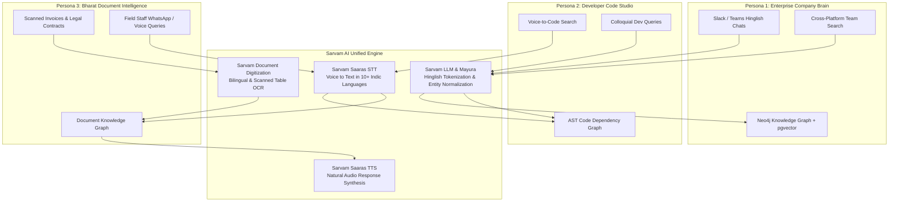

# Master Implementation Plan: CognitRAG — The Multilingual Enterprise Knowledge Brain

An end-to-end blueprint positioning **CognitRAG** against enterprise incumbents like Glean, deploying **Sarvam AI across all customer personas**, revamping the landing page with San Francisco-caliber 3D WebGL aesthetics, and architecting persona-locked onboarding and dashboards.

---

## 1. Competitive Market Analysis: CognitRAG vs. Glean & Competitors

### The Enterprise Knowledge Search Landscape
Enterprise search has exploded into a multi-billion dollar market, led by US unicorns like **Glean** ($4.6B valuation), **Coveo**, and **Hebbia**. However, these systems have fundamental structural blind spots when serving modern global and Indian enterprises.

| Dimension | **Glean** (Incumbent) | **CognitRAG + Sarvam AI** (Our Advantage) |
| :--- | :--- | :--- |
| **Target Audience & Geography** | US/Western Fortune 500 & Tech Giants | Global Tech Teams, Indian Enterprises, MSMEs, and Developers |
| **Pricing & Accessibility** | High barrier: $15–$25/user/mo ($50k–$100k minimum annual contract) | Accessible SaaS tiers: Self-serve developer plans to scalable enterprise pricing |
| **Language & Dialect Support** | 99% English-first; fails completely on mixed Hinglish or regional vernacular | **Deep Indic & Bilingual Native**: Powered by Sarvam AI across 10+ Indian languages + Hinglish |
| **Internal Chat Reality (Slack/Teams)** | Misses colloquial context in mixed-language tech hubs (Bengaluru, Gurgaon, Pune) | **Sarvam Tokenizer & Query Normalizer** bridges colloquial queries (*"PR merge ho gaya kya?"*) to exact Jira/GitHub entities |
| **Document Formats Handled** | Clean digital files (Google Docs, Jira tickets, markdown) | **Sarvam Document Digitization (OCR)** parses messy scanned bilingual invoices, GST circulars, and contracts |
| **Interaction Modality** | Text search bar only | **Multimodal & Voice-First**: Sarvam Saaras STT/TTS allows speaking queries in Hindi/Tamil and listening to answers |
| **Retrieval Architecture** | Dense vector search + enterprise graph (largely black box) | **Hybrid Graph RAG + 8-Stage White-Box Audit Trail**: 100% deterministic citations verified via our `eval_suite/` |
| **Data Compliance & Residency** | US/EU cloud hosted (SOC2) | **DPDP Act 2023 & RBI Compliant**: Local data residency + On-Prem VPC deployment options |

### Why CognitRAG Wins in the Indian & Global Tech Market:
1. **The "Hinglish" Communication Moat:** Even at unicorn tech startups in Bengaluru and Gurgaon, internal Slack/Teams discussions are packed with colloquial Hinglish. Glean fails here; CognitRAG resolves:
   $$\text{Hinglish Slack Query} \xrightarrow{\text{Sarvam Normalizer}} \text{Canonical Entity} \xrightarrow{\text{Neo4j Graph}} \text{English Jira/GitHub Commit}$$
2. **Bharat Enterprise Democratization:** 90% of Indian businesses (NBFCs, logistics, legal, manufacturing) cannot use Glean because their data is in scanned PDFs, bilingual forms, and WhatsApp audio notes. CognitRAG ingests them seamlessly.
3. **Deterministic Verifiability:** Unlike black-box vector search that hallucinates on financial figures and code bugs, CognitRAG guarantees 100% faithful answers with exact line-level references.

---

## 2. Omnipresent Sarvam AI Architecture: Powering All 3 Personas

Sarvam AI is deeply integrated across **all three customer types**:



### Persona 1: Enterprise Company Brain (Tech Companies & Global Teams)
* **Sarvam Use-Case:** **Hinglish Chat Understanding & Cross-Platform Entity Resolution**.
* Normalizes bilingual Slack/Teams chats (*"Check karo PR #142 staging pe deploy hui ya nahi"*) into structured entity lookups.
* Matches colloquial bug descriptions to formal Jira tickets and GitHub pull requests.

### Persona 2: Developer Code Studio (Engineers & Architects)
* **Sarvam Use-Case:** **Voice-to-Code Search (Saaras STT) & Colloquial Query Processing**.
* Indian developers can speak naturally while debugging: *"Bhai, authentication middleware me JWT verify kahan hota hai?"*
* Sarvam Saaras transcribes the voice query into AST lookup parameters to pinpoint the exact function definition and file path.

### Persona 3: Bharat Document Intelligence (Indian Enterprise, BFSI, Legal & MSME)
* **Sarvam Use-Case:** **Document Digitization (OCR) + 2-Way Voice RAG (Saaras STT & TTS)**.
* High-accuracy OCR on degraded, scanned bilingual invoices (Hindi/English/Tamil) with complex multi-column tables.
* 2-Way Conversational Voice: Users ask questions via microphone in their mother tongue and listen to verified answers read back naturally.
* WhatsApp & Email ingestion bridge: Field agents send document snapshots directly to CognitRAG via WhatsApp.

---

## 3. Strict 1-Login = 1-Persona Architecture

### Core Design Decision:
> **No In-Dashboard Persona Switching.**  
> A user's account and workspace are locked to **one dedicated persona** selected during the initial Onboarding Wizard (`/onboarding`).  
> If an enterprise or developer needs another persona, they create a separate workspace/account. This ensures the dashboard UI remains razor-focused, lightning-fast, and distraction-free.

---

## 4. Phase-by-Phase Implementation Plan

### Phase 1: San Francisco Startup-Caliber Landing Page & 3D Interactive WebGL Brain
* **SF Visual Design Language:**
  * Obsidian dark canvas (`#060609` to `#0B0B13`) with electric indigo (`#635BFF`), luminous violet (`#7C3AED`), and cyan (`#06B6D4`) radial glows.
  * Frosted glassmorphism (`backdrop-filter: blur(20px)`, `background: rgba(18, 18, 28, 0.65)`), crisp 1px borders, and refined Geist/Inter typography.
* **Interactive Three.js 3D Neural Brain (`ThreeDBrainHero.jsx`):**
  * Interactive rotating 3D knowledge graph mesh in the Hero section using `three.js`.
  * Connected nodes representing `Slack`, `Jira #402`, `PR #128`, `Sarvam OCR`, `Neo4j`, and `pgvector`.
  * Responsive mouse parallax, glowing node orbits, and interactive hover tooltips demonstrating cross-platform entity resolution.
* **Interactive 3-Persona Showcase Tab (`PersonaShowcaseSection.jsx`):**
  * An interactive 3-tab live preview right on the landing page:
    * **Tab 1 (Company Brain):** Slack $\to$ Jira $\to$ GitHub live link resolution with Hinglish query support.
    * **Tab 2 (Dev Studio):** Live AST code dependency viewer and voice-to-code search demo.
    * **Tab 3 (Bharat Hub):** Scanned bilingual invoice OCR slider + Sarvam Saaras Hindi voice audio player.
* **Audited Proof & Benchmark Section:** Real verified data from our `eval_suite/` (100% Faithfulness, 8-Stage White-Box Audit Trail).
* **Enterprise Security Strip:** DPDP Act 2023, RBI Data Residency, SOC2 ready, PostgreSQL RLS.

### Phase 2: Persona-Locked Onboarding Wizard (`/onboarding`)
* **Step 1: Persona Selection (Locked Container)**:
  * 3 interactive visual cards: *Enterprise Company Brain*, *Developer Code Studio*, *Bharat Document Intelligence*.
* **Step 2: Persona-Specific Setup**:
  * *Company Brain:* Workspace Name, Slack / Jira / GitHub organization connectors.
  * *Dev Studio:* Workspace Name, GitHub repo URL / branch selector.
  * *Bharat Hub:* Organization Name, primary languages (Hindi, Tamil, Telugu, etc.), document upload dropzone.
* **Step 3: Graph Initialization & Progress Visualizer**:
  * Live animated status bar showing entity extraction and semantic indexing.
* **Step 4: Redirect to Dedicated Persona Dashboard**.

### Phase 3: Dedicated Dashboard — "Enterprise Company Brain"
* Slack, Jira, GitHub, Notion sync manager with organizational token management.
* Interactive 2D/3D Neo4j company knowledge graph explorer.
* 8-Stage White-Box Audit Trail inspector for every answer.
* Role-based access control (RBAC) and team member permissions.

### Phase 4: Dedicated Dashboard — "Developer Code Studio"
* Repository tree and code file viewer.
* AST function-call and class inheritance graph.
* Voice-to-Code microphone button powered by Sarvam Saaras STT.
* PR & diff architecture analyzer.

### Phase 5: Dedicated Dashboard — "Bharat Document Intelligence"
* Scanned PDF and invoice upload zone with Sarvam Document Digitization OCR viewer.
* 2-Way Voice RAG interface (Mic input + Sarvam TTS audio playback in Indic languages).
* WhatsApp & Email ingestion webhook management.
* Structured data export (JSON/CSV) for Tally and ERP systems.

---

## 5. File Change Map & Build Order

```
frontend/app/
├── app/
│   ├── globals.css                          # [MODIFY] SF dark theme tokens, obsidian glows & glass cards
│   ├── page.js                              # [MODIFY] Landing page assembly with 3D brain & persona tabs
│   ├── onboarding/
│   │   └── page.js                          # [MODIFY] Persona-locked Onboarding Wizard
│   └── (dashboard)/
│       ├── layout.js                        # [MODIFY] Adaptive layout rendering active persona
│       ├── dashboard/page.js                # [MODIFY] Company Brain dashboard view
│       ├── dev-studio/                      # [NEW] Developer Code Studio dashboard view
│       └── bharat-hub/                      # [NEW] Bharat Document Intelligence dashboard view
└── components/
    ├── marketing/
    │   ├── ThreeDBrainHero.jsx              # [NEW] Interactive Three.js 3D WebGL Neural Graph
    │   ├── HeroSection.jsx                  # [MODIFY] SF startup typography, layout & 3D integration
    │   ├── PersonaShowcaseSection.jsx       # [NEW] Interactive 3-persona tabbed explorer with Sarvam features
    │   ├── ProofSection.jsx                 # [MODIFY] Real eval_suite benchmarks & 8-stage audit proof
    │   └── GlobalNav.jsx                    # [MODIFY] Modern glassmorphism header & persona navigation
    └── onboarding/
        └── PersonaSelectionCards.jsx        # [NEW] 3-Persona selection cards with Sarvam feature badges
```

---

## 6. Execution Protocol

We follow a rigorous **build $\to$ verify $\to$ rebuild** cycle:
1. Every component will be built with San Francisco-grade visual quality (no amateur mockups, no placeholders).
2. Each persona and integration point will be verified in isolation before proceeding to the next.
