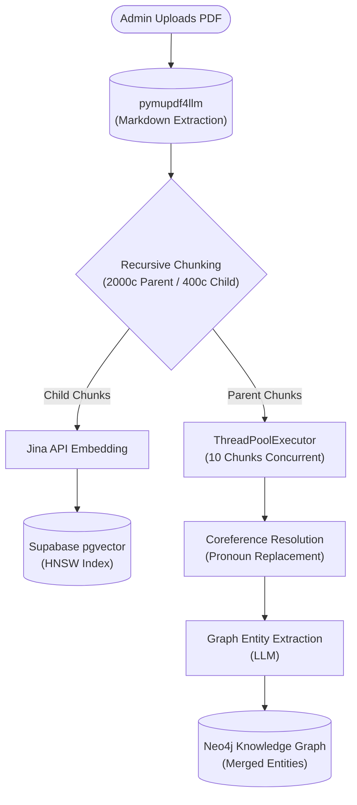
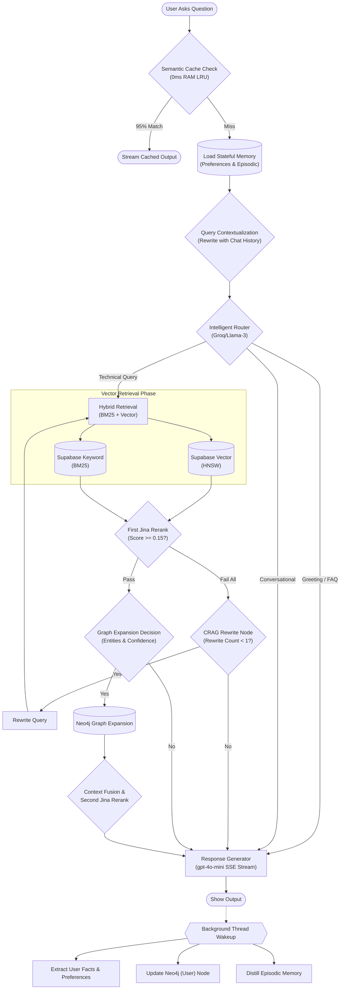

# Multi-Tenant RAG SaaS Platform

This is a Retrieval-Augmented Generation (RAG) platform with strict Multi-Tenancy isolation. It allows users to upload documents and query them using an Agentic LLM workflow.

## Features
- **Multi-Tenant Isolation:** Supabase Row Level Security (RLS) ensures chunks are completely isolated.
- **Hybrid Search (RRF):** Fuses Vector Search (Jina Embeddings in pgvector), Keyword Search (Postgres FTS), and Graph Search (Neo4j Cypher).
- **Agentic Routing:** Uses LangGraph and Groq (`llama-3.1-8b-instant`) to classify user intents (Greeting vs Technical), grade documents, and rewrite bad queries.
- **Generative Chat:** Uses `sarvam-30b` to synthesize answers seamlessly with LangGraph native asynchronous token streaming.

## Workflow Architecture

### Phase 1: Document Ingestion (The Admin Pipeline)

### Phase 2: The Chat Request (The User Pipeline)

## Code Architecture Deep-Dive

### 1. Document Ingestion Pipeline (src/ingestion/pipeline.py & 
outes.py)
- **Trigger:** Admin uploads a file via the /api/v1/ingest endpoint.
- **Background Task:** FastAPI triggers ackground_ingestion_pipeline to avoid blocking the HTTP response.
- **Parsing:** parse_pdf() uses pymupdf4llm to convert the raw PDF bytes into a clean Markdown representation. A fallback to standard itz (PyMuPDF) is used if markdown extraction fails.
- **Cleaning:** clean_financial_text() strips XML/XBRL tags, URLs, and noisy numerical table artifacts.
- **Chunking:** RecursiveCharacterTextSplitter generates **2000-character Parent Chunks** (for context) and **400-character Child Chunks** (for strict vector search).
- **Embeddings:** Child chunks are grouped into batches of 50 and sent to AWS Bedrock (mazon.titan-embed-text-v2:0) via litellm to generate 1536-dimensional vector embeddings.
- **Storage:** Vectors are pushed into Supabase pgvector (chunks table) linking back to the 	enant_id for strict RLS isolation.
- **Graph Extraction:** A ThreadPoolExecutor (limited to max_workers=1 for memory constraints on 1GB AWS instances) runs process_parent_chunk(). This executes a Coreference Resolution prompt via Llama-3-70b (replacing pronouns like "it" with explicit nouns) and merges the extracted relationships into Neo4j using Cypher (MERGE).

### 2. Retrieval & Query Pipeline (src/retrieval/nodes.py & hybrid.py)
- **Trigger:** User sends a chat message via /api/v1/chat.
- **LangGraph State:** The state is initialized with the question, 	enant_id, and chat_history.
- **Contextualization:** The contextualize_query node uses gpt-4o-mini to rewrite the user's latest question into a standalone query that encompasses the entire chat history.
- **Embedding:** get_embedding() (with an in-memory LRU Cache) vectorizes the standalone query.
- **Routing:** The 
oute_query node classifies the intent as Greeting, Conversational, or Technical. Technical queries proceed to retrieval.
- **Hybrid Search:** ector_search() performs a simultaneous HNSW Vector Search (pgvector) and Keyword Search (BM25) on Supabase, then fuses the results using Reciprocal Rank Fusion (RRF).
- **First Rerank:** grade_documents node evaluates relevance. If all documents fail, the 
ewrite_query node (CRAG) alters the search terms and loops back to retrieval.
- **Graph Expansion:** The graph_decision node determines if multi-hop entity reasoning is required. If yes, it executes a Cypher query on Neo4j to pull relational strings.
- **Generation:** The generate node feeds the fused Context, Graph Strings, Long-Term Memory, and User Preferences into gpt-4o-mini. The output is streamed back to the frontend using Server-Sent Events (SSE).

### Step-by-Step Flow

#### Phase 1: Document Ingestion (The Admin Pipeline)
1. **Text Extraction:** `pymupdf4llm` converts the raw PDF into structured Markdown.
2. **Recursive Parent-Child Chunking:** Markdown is sliced into 400-character "Child" chunks (for precise vectors) and 2,000-character "Parent" chunks (for LLM context).
3. **Concurrent Vectorization:** Child chunks are converted into 1536-dimensional vectors via Jina API and saved to Supabase using an **HNSW index** for sub-millisecond searching.
4. **Graph Extraction:** A background `ThreadPoolExecutor` grabs 10 Parent chunks at a time. It performs **Coreference Resolution** (replacing pronouns) and extracts Graph Entities/Relationships, safely merging them into Neo4j.

#### Phase 2: The Chat Request (The User Pipeline)
1. **Exact-Match Semantic Cache (`check_cache`):** The system securely checks the query against past queries using a blazing-fast RAM `LRUCache`. A 95% match instantly streams the cached answer.
2. **Stateful Memory Injection (`load_memory`):** Fetches the user's Long-Term Memory (Rules/Preferences, Vector Facts, and Episodic chat summaries) and injects it into the LangGraph state.
3. **Query Contextualization (`contextualize_query`):** Rewrites follow-up questions using short-term chat history into standalone queries.
4. **Intelligent Routing (`route_query`):** Categorizes intent. `Greeting` or `Conversational` intents bypass Vector Search entirely, heading straight to the Generator.
5. **Retrieval (`retrieve`):** Queries Vectors (HNSW) and Keywords (BM25) to fetch initial document candidates.
6. **First Rerank & CRAG (`grade_documents`):** The retrieved chunks are graded by `jina-reranker-v2`. Any chunk scoring below `0.15` is discarded. If all chunks fail, a CRAG loop rewrites the query and searches again (max 1 rewrite).
7. **Graph Decision & Expansion (`graph_decision`):** If surviving chunks contain multiple entities and search confidence was high, a cheap LLM call verifies if traversing the graph is needed. If true, relationships are fetched from the Neo4j Knowledge Graph.
8. **Context Fusion & Second Rerank (`fuse_and_rerank`):** The new graph sentences are combined with the vector chunks, and the Jina reranker runs a second time to fuse and select the most relevant mixed context pool.
9. **Asynchronous Streaming (`generate`):** The final context (Top 15 items), preferences, and history are sent to `gpt-4o-mini`. Tokens stream instantly back to the UI via Server-Sent Events (SSE).
10. **Background Extraction (`save_memory`):** After the response, a background thread uses `sarvam-30b` to extract new facts, dynamically connect the Neo4j `(User)` node, and distill older messages into a rolling summary.

## Frontend UI & Dashboard Tabs
The platform features a modern Next.js (React) frontend divided into several distinct dashboard tabs. Here is the complete breakdown of the text and functionality presented across the UI:

- **/home**: Landing dashboard. _"All knowledge layers are synchronized and ready for queries."_
- **/ai/mcp**: **Model Context Protocol (MCP)** - Manages SSE Web Transport and Standard I/O Transport for external integrations.
- **/ask**: The primary conversational chat interface where employees interact with the RAG system using Server-Sent Events (SSE) to stream the LangGraph cognitive steps.
- **/billing**: **Billing & Usage** - Tracks Agent Execution, Custom Workflows, and Vector Documents against the Pro Plan.
- **/brain-bills**: **Transaction History** - Displays "Total Tokens Used" and "Estimated Cost" by tracking transactions from the database.
- **/dashboard**: General overview of system metrics and current status.
- **/integrations**: **Connectors** - _"Connect external tools to build your semantic knowledge graph."_ (Currently supports OAuth connections for Notion, GitHub, Slack, Jira, Google Drive).
- **/knowledge**: **Knowledge Library** - _"Review your ingested documents and verified memories."_ Displays all uploaded PDFs and their ingestion status.
- **/knowledge/graph**: **Graph Explorer** - _"Interactive 3D visualization of your workspace relationship intelligence."_
- **/memory-hub**: **Memory Hub** - _"Central administration for the four pillars of Workspace Memory and Security."_ Manages established facts from documents/chat and rules/formatting preferences the AI must explicitly follow.
- **/metrics**: **System Metrics** - _"Monitor the precision and recall of your Knowledge Graph and Vector hybrid searches."_ Analyzes LLM inference speeds, hallucination rates, and semantic alignment.
- **/playground**: **AI Playground** - _"Interact with your Workspace Memory. Bring your own model (OpenAI, Claude, Gemini)."_
- **/security**: **Security & Access** - _"Manage workspace members, roles, and audit logs."_ Enforces Role-Based Access Control (RBAC).
- **/semantic-dictionary**: **Semantic Dictionary** - _"Govern your business definitions. AI Agents strictly adhere to these definitions when calculating metrics or answering questions."_
- **/settings**: **Workspace Settings** - _"Invite colleagues, assign roles, and manage permissions... Override dynamic routing and force specific models... Configure data retention policies."_
- **/timeline**: **Workspace Timeline** - _"Chronological evolution of the workspace: decisions, migrations, and key milestones."_

## Frontend UI & Authentication
The platform features a modern React (Vite) frontend, split into two primary interfaces:
- **Company Portal:** Allows authenticated admins to upload new documents (PDFs), monitor ingestion status, view token billing metrics, and execute safe Neo4j Graph Garbage Collection to completely wipe documents from all databases.
- **Employee Portal:** A sleek chat interface where employees can interact with the RAG system. It features Server-Sent Events (SSE) to stream the LangGraph cognitive steps in real-time, providing transparency into the AI's thought process (e.g., "Routing Query", "Retrieving from Vector & Graph").

**Multi-Tenancy with Clerk:**
Authentication is handled via Clerk. When an admin registers a company, their unique Clerk `user_id` (e.g., `user_3FGB...`) acts as the strict `tenant_id` that is mathematically enforced across the Supabase Row Level Security (RLS) policies, the pgvector vector store, and the Neo4j Knowledge Graph. The database schema has been refactored to use native `TEXT` types rather than UUIDs to perfectly synchronize with Clerk's format, ensuring Company A can never access Company B's data.

## Getting Started

1. Clone the repository.
2. Install dependencies via `uv`.
3. Set up your `.env` file (see `implementation.md` for details).
4. Run the FastAPI server: `uvicorn src.main:app --reload`
5. Visit `http://localhost:8000` to interact with the API or Web UI.

See `implementation.md` for a full breakdown of the architecture and database schema details.
