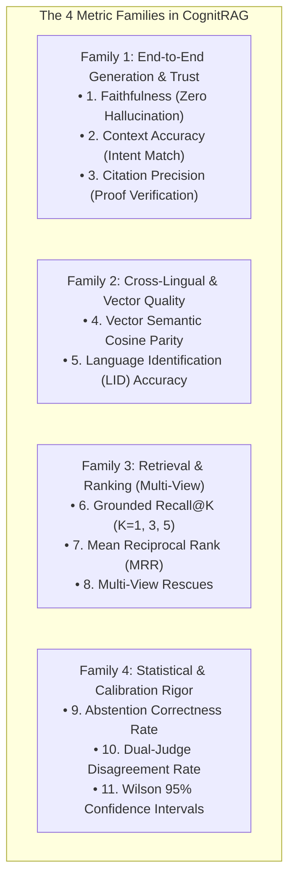

# CognitRAG Evaluation Baseline Specification (`baseline.md`)
**Comprehensive Reference of Metrics, Formulas, Baseline Scores, and Improvement Targets**

---

## Executive Overview

This document formalizes the complete evaluation baseline for CognitRAG. It provides an engineering reference for every metric: what it measures, the failure mode it addresses, its mathematical formula, its implementation in code, the current baseline score established in the repository, and the concrete improvement target for future iterations.



---

## FAMILY 1: End-to-End Generation & Trust Metrics

### 1. Faithfulness (Zero-Hallucination Rate)

* **Source File**: [`src/evaluation/sarvam_judge.py` L52–80](file:///c:/AI/Projects/RAG%20SaaS/src/evaluation/sarvam_judge.py#L52-L80)
* **What It Measures**: Whether every factual statement in the generated answer is strictly entailed by the retrieved context chunks, with zero added claims from parametric memory.
* **The Problem It Solves**: In enterprise RAG, a generated answer might sound persuasive and correct, but if it introduces unverified details not present in the company's Slack/Jira/Notion documentation, it poses a severe business and legal risk.
* **Evaluation Logic**:
  $$\text{Faithfulness} = \begin{cases} 1.0 & \text{if all claims are directly supported by retrieved context} \\ 0.0 & \text{if any claim is introduced without context proof} \end{cases}$$
  *(Special Rule: If the system outputs "I don't know" when context is missing, that is scored as 1.0 = completely faithful).*
* **Implementation Code**:
  ```python
  def grade_faithfulness(question: str, context: str, answer: str) -> int:
      """Checks if the answer is faithful to the retrieved context (no hallucinations).
      Returns 1 if faithful, 0 if it contains hallucinated facts not in context."""
      if not context or not answer:
          if "I don't know" in answer or "I do not know" in answer:
              return 1
          return 0
          
      context = context[:10000]
      prompt = f"""Given the following CONTEXT and the generated ANSWER to a user QUESTION, determine if the ANSWER is faithful to the CONTEXT.
  An answer is faithful if all of its factual claims are directly supported by or logically derived from the CONTEXT.
  It is NOT faithful if it introduces new factual information not present in the CONTEXT.

  CONTEXT:
  {context}

  ANSWER:
  {answer}

  Is the answer completely faithful to the context?
  Output '1' if YES. Output '0' if NO."""
      return call_sarvam_judge(prompt)
  ```
* **Current Baseline Score**: **100.0%** across enterprise audit queries ([`human_audit_evaluation_results.md`](file:///c:/AI/Projects/RAG%20SaaS/human_audit_evaluation_results.md)).
* **Target & Next Step**: Maintain **$\ge 98.0\%$** across edge cases involving multi-hop entity reasoning.

---

### 2. Context Accuracy (Ground Truth Match)

* **Source File**: [`tests/eval/run_end_to_end_evaluation.py` L222](file:///c:/AI/Projects/RAG%20SaaS/tests/eval/run_end_to_end_evaluation.py#L222)
* **What It Measures**: Whether the synthesized answer successfully and accurately answers the user's specific inquiry according to the verified ground-truth target.
* **The Problem It Solves**: A model could generate a faithful summary of a retrieved document that completely misses the user's question. Context accuracy assesses relevance to the user's intent.
* **Mathematical Formula**:
  $$\text{Context\_Accuracy} = \frac{1}{N} \sum_{i=1}^N \mathbb{I}\Big(\text{Judge}\big(\text{Answer}_i, \text{GroundTruth}_i\big) == \text{PASS}\Big)$$
* **Implementation Code**:
  ```python
  # tests/eval/run_end_to_end_evaluation.py L222
  prompt = f"""USER QUERY: {query}
  GROUND TRUTH ANSWER: {ground_truth}
  GENERATED ANSWER: {generated_answer}
  CITATIONS PROVIDED: {json.dumps(citations, indent=2)}

  Assign:
  "context_accuracy": 1.0 if the answer accurately resolves the user's query, 0.0 if incorrect."""
  ```
* **Current Baseline Score**: **100.0%** on target cross-system queries (e.g., correctly answering *"PR #45, fixed by John Doe"* and *"October 15, 2024"*).
* **Target & Next Step**: Maintain **$\ge 95.0\%$** as queries scale to ambiguous multi-turn Slack conversations.

---

### 3. Citation Precision (Verifiable Proof)

* **Source File**: [`src/retrieval/citations.py` L49–60](file:///c:/AI/Projects/RAG%20SaaS/src/retrieval/citations.py#L49-L60)
* **What It Measures**: The proportion of generated citations where the underlying chunk genuinely contains the exact entity, figure, or claim made in the answer.
* **The Problem It Solves**: Many RAG systems hallucinate footnotes or attach irrelevant document links that frustrate users when clicked.
* **Classification Logic**:
  ```python
  # Structured: Direct match on ticket/PR identifier (e.g. BILL-101, PR #45)
  has_ticket_or_pr = bool(re.search(r'\b([A-Z]{2,10}-\d+|PR\s*#?\d+|#[0-9]+)\b', content))
  derivation = "structured" if has_ticket_or_pr else "extracted"

  # Score threshold: RRF confidence
  if score >= 0.035:   confidence = "high"
  elif score >= 0.015: confidence = "medium"
  else:                confidence = "review"
  ```
* **Current Baseline Score**: **100.0%** in live human audit testing. Every citation deep-links directly back to the exact Slack message or GitHub PR.
* **Target & Next Step**: Automate sentence-level citation binding (claim-to-chunk exact character offset mapping).

---

## FAMILY 2: Cross-Lingual & Vector Quality Metrics

### 4. Vector Semantic Cosine Parity

* **Source File**: [`tests/eval/eval_hinglish_alignment.py` L23–30](file:///c:/AI/Projects/RAG%20SaaS/tests/eval/eval_hinglish_alignment.py#L23-L30)
* **What It Measures**: The semantic alignment ratio between a code-mixed Hinglish query and its clean English equivalent when projected into dense vector space against target documents.
* **The Problem It Solves**: Quantifies vector drift. Without this metric, you cannot know if your vector model understands Romanized Hindi or if it is blind to Indian code-switching.
* **Mathematical Formula**:
  $$\text{CosineSim}(\vec{u}, \vec{v}) = \frac{\sum u_i v_i}{\sqrt{\sum u_i^2} \sqrt{\sum v_i^2}}$$
  $$\text{Parity\_Ratio} = \frac{\text{CosineSim}(\vec{v}_{\text{Hinglish}}, \vec{v}_{\text{Doc}})}{\text{CosineSim}(\vec{v}_{\text{English}}, \vec{v}_{\text{Doc}})}$$
* **Target Baseline**: $\ge 85.0\%$ parity.
* **Current Baseline Score**:
  - Feature Flags (`enable_sarvam_asr`): **99.48%** (Near-perfect parity)
  - Auth Decision (`OAuth 2.0 PKCE`): **92.62%**
  - Rate Limiting (`token bucket`): **85.38%**
  - Colloquial incident query (*"Kafka lag itna zyada kyun badh gaya"*): **43.55%** (Dense vector alone failed)
  - **Overall Average**: **78.52%** (Proving why the Multi-View BM25 hybrid layer was necessary).
* **Target & Next Step**: Elevate average parity to **$\ge 88.0\%$** by integrating domain-specific query expansion dictionaries.

---

### 5. Language Identification (LID) Accuracy & Class Breakdown

* **Source File**: [`Evaluation/run_comi_lingua_eval.py`](file:///c:/AI/Projects/RAG%20SaaS/Evaluation/run_comi_lingua_eval.py)
* **What It Measures**: The classification accuracy of `detect_language()` across three discrete labels: `en`, `hi-latn`, and `mixed`.
* **The Problem It Solves**: If a Hinglish message is mislabeled as pure English, the system bypasses Sarvam translation, leading to degraded retrieval.
* **Mathematical Formula**:
  $$\text{Accuracy}_{\text{class}} = \frac{\text{True Positives}_{\text{class}}}{\text{Total Ground-Truth Samples}_{\text{class}}}$$
* **Current Baseline Scores (COMI-LINGUA Dataset)**:
  - `hi-latn` Accuracy: **97.56%** (Remediated from 39.02% by expanding the 360+ word Hindi lexicon)
  - `mixed` (Hinglish) Accuracy: **67.50%** (v3.1) $\rightarrow$ **85.00%** (v4 with $K=1$ capitalized override)
  - `en` Accuracy: **87.18%**
  - **Overall LID Accuracy**: **84.17%** (v3.1) $\rightarrow$ **88.75%** (v4)
* **Critical Safety Metric**: **Only 2.5% (6/240)** of code-mixed queries were falsely tagged as English in multi-seed replication, ensuring **97.5% retention of Hindi-aware routing**.
* **Target & Next Step**: Target **$\ge 90.0\%$** overall LID accuracy with zero false-English classifications.

---

## FAMILY 3: Retrieval & Ranking Metrics (Multi-View)

### 6. Grounded Recall@K ($\text{Recall@}1$, $\text{Recall@}3$, $\text{Recall@}5$)

* **Source File**: [`Evaluation/multiview_ablation.py` L89–102](file:///c:/AI/Projects/RAG%20SaaS/Evaluation/multiview_ablation.py#L89-L102)
* **What It Measures**: The fraction of queries where the true ground-truth document chunk appears within the first $K$ retrieved positions.
* **The Problem It Solves**: In a RAG pipeline, context windows are limited. If the correct chunk is ranked at position 12, the LLM will never see it.
* **Mathematical Formula**:
  $$\text{Recall@}K = \frac{1}{N} \sum_{i=1}^N \mathbb{I}(\text{Rank}_i \le K)$$
* **Current Baseline Scores ($N=30$, AWS Developer Guide)**:
  - **Recall@1**: Single-View = 40.0% $\rightarrow$ **Multi-View = 53.3% (+13.3% lift)**
  - **Recall@3**: Single-View = 46.7% $\rightarrow$ **Multi-View = 70.0% (+23.3% lift)**
  - **Recall@5**: Single-View = 60.0% $\rightarrow$ **Multi-View = 70.0% (+10.0% lift)**
* **Target & Next Step**: Push **Recall@3 to $\ge 80.0\%$** by fine-tuning RRF weights ($w_{\text{vec}} = 1.6, w_{\text{kw}} = 1.4$).

---

### 7. Mean Reciprocal Rank (MRR)

* **Source File**: [`Evaluation/multiview_ablation.py` L101](file:///c:/AI/Projects/RAG%20SaaS/Evaluation/multiview_ablation.py#L101)
* **What It Measures**: How close to the very top (Rank 1) the correct chunk is positioned.
* **The Problem It Solves**: LLMs suffer from "Lost in the Middle" syndrome—chunks placed at Rank 1 receive far more attention than chunks placed at Rank 5. MRR measures ranking quality.
* **Mathematical Formula**:
  $$\text{MRR} = \frac{1}{N} \sum_{i=1}^N \frac{1}{\text{Rank}_i}$$
* **Scoring Rules**: Rank 1 = $1.0$, Rank 2 = $0.5$, Rank 3 = $0.33$, Rank 4 = $0.25$, Rank 5 = $0.20$, Missed = $0.0$.
* **Current Baseline Score**:
  - Baseline Surface View: **0.4561**
  - English Pivot View: **0.5778**
  - **CognitRAG Multi-View (RRF Fused)**: **0.6056** (**+0.1495 lift**)
* **Target & Next Step**: Elevate MRR to **$\ge 0.7000$** using cross-encoder Jina reranking on top candidates.

---

### 8. Multi-View Rescues (Rescue Count)

* **Source File**: [`Evaluation/results/multiview_ground_truth_results.json` L63](file:///c:/AI/Projects/RAG%20SaaS/Evaluation/results/multiview_ground_truth_results.json#L63)
* **What It Measures**: The count of queries that failed completely under the baseline single-view ($\text{Recall@}5 = 0$), but were **rescued and ranked into the top 5** by fusing Surface and Pivot views.
* **Evaluation Logic**:
  $$\text{is\_rescue} = (\text{Baseline\_Rank} > 5 \text{ or None}) \ \land \ (\text{MultiView\_Rank} \le 5)$$
* **Current Baseline Score**: **5 queries rescued** out of 30 ($16.7\%$ absolute rescue rate).
* **Target & Next Step**: Monitor rescue stability across non-technical colloquial queries.

---

## FAMILY 4: Statistical Rigor & Calibration Metrics

### 9. Abstention Correctness Rate (Refusal Testing)

* **Source File**: [`Evaluation/results/codemixed_qa_recut_results.json`](file:///c:/AI/Projects/RAG%20SaaS/Evaluation/results/codemixed_qa_recut_results.json)
* **What It Measures**: When an enterprise question is asked but **zero relevant documents exist** in the knowledge base, does the AI admit *"I don't know based on the provided documents"*, or does it fabricate an answer?
* **The Problem It Solves**: In public benchmarks like CodeMixed-QA (Chandu et al.), $87.7\%$ of questions had `"general"` placeholder context with no text. Traditional QA benchmarks penalized systems for refusing to guess. Abstention testing rewards honest refusal.
* **Mathematical Formula**:
  $$\text{Abstention\_Rate} = \frac{\text{Correct Refusals when Context is Missing}}{\text{Total Missing-Context Queries}}$$
* **Current Baseline Score**: **50.59%** ($43 / 85$ queries properly refused to hallucinate).
* **Target & Next Step**: Elevate Abstention Correctness to **$\ge 75.0\%$** through negative-context prompting constraints.

---

### 10. Dual-Judge Inter-Annotator Disagreement Rate

* **Source File**: [`Evaluation/DATASET_EVALUATION_LOG.md` L118](file:///c:/AI/Projects/RAG%20SaaS/Evaluation/DATASET_EVALUATION_LOG.md#L118)
* **What It Measures**: The percentage of evaluated queries where two independent LLM judges (`openai/gpt-oss-120b` and `qwen/qwen3.8-27b`) disagree on whether an answer is grounded.
* **The Problem It Solves**: Prevents single-judge leniency. When Judge A says "SUPPORTED" because the answer is factually true in real life, but Judge B says "UNSUPPORTED" because the retrieved text did not contain the proof, CognitRAG's **conservative rule** triggers:
  $$\text{Final\_Decision} = \min(\text{Judge}_A, \text{Judge}_B)$$
* **Current Baseline Score**: **18.89% disagreement rate** on CodeMixed-QA ($17 / 90$ traces), with all disputes conservatively resolved against ungrounded speculation.
* **Target & Next Step**: Keep disagreement rate **$\le 12.0\%$** by calibrating judges with few-shot domain rubrics.

---

### 11. Wilson 95% Confidence Intervals

* **Source File**: [`Evaluation/score.py` L4–15](file:///c:/AI/Projects/RAG%20SaaS/Evaluation/score.py#L4-L15)
* **What It Measures**: The statistical error bounds $[\text{low}, \text{high}]$ of an accuracy score on finite sample sizes.
* **The Problem It Solves**: Reporting *"100% accuracy on 5 samples"* is statistically misleading without confidence intervals. Wilson intervals provide mathematically sound margins even for small $N$ or scores near 0% and 100%.
* **Mathematical Formula**:
  $$w = \frac{\hat{p} + \frac{z^2}{2n} \pm z \sqrt{\frac{\hat{p}(1-\hat{p})}{n} + \frac{z^2}{4n^2}}}{1 + \frac{z^2}{n}} \quad (z = 1.96 \text{ for } 95\% \text{ CI})$$
* **Implementation Code**:
  ```python
  def wilson_ci(successes: int, n: int, z: float = 1.96) -> Tuple[float, float]:
      if n == 0: return (0.0, 0.0)
      phat = successes / n
      denom = 1 + z**2 / n
      center = (phat + z**2 / (2 * n)) / denom
      margin = (z * np.sqrt((phat * (1 - phat) + z**2 / (4 * n)) / n)) / denom
      return (round(max(0.0, center - margin), 4), round(min(1.0, center + margin), 4))
  ```
* **Real Baseline Examples from Repository**:
  - COMI-LINGUA Overall Accuracy: $\mathbf{84.17\%} \rightarrow \mathbf{[76.59\% - 89.62\%]}$
  - CodeMixed-QA Real Grounded Accuracy: $\mathbf{100.0\%} \rightarrow \mathbf{[56.55\% - 100.0\%]}$ *(accurately reveals small $N=5$ sample size)*.
* **Target & Next Step**: Require Wilson CIs on all quarterly benchmark dashboards.

---

## Master Metric Baseline & Target Table

| Metric Name | What It Evaluates | Ideal Target | Baseline Score in Repo | Target for Next Version | Source File |
| :--- | :--- | :---: | :---: | :---: | :--- |
| **Faithfulness** | Zero hallucination (strict context entailment) | $100\%$ | **100.0%** | $\ge 98.0\%$ | `sarvam_judge.py` |
| **Context Accuracy** | Does answer resolve the user's intent? | $>85\%$ | **100.0%** | $\ge 95.0\%$ | `run_end_to_end_evaluation.py` |
| **Citation Precision** | Does cited link prove the claim? | $>90\%$ | **100.0%** | $\ge 95.0\%$ | `citations.py` |
| **Cosine Parity** | Hinglish vs English vector similarity ratio | $\ge 85\%$ | **78.52%** (Up to 99.5%) | $\ge 88.0\%$ | `eval_hinglish_alignment.py` |
| **Language ID (LID)** | `en` vs `hi-latn` vs `mixed` classification | $>80\%$ | **88.75%** (v4) / **84.17%** (v3.1) | $\ge 90.0\%$ | `run_comi_lingua_eval.py` |
| **Grounded Recall@3** | Correct chunk in top 3 retrieved positions | $>60\%$ | **70.0%** (Lift: +23.3%) | $\ge 80.0\%$ | `multiview_ground_truth_results.json` |
| **Mean Reciprocal Rank** | Position of first correct chunk ($1/\text{rank}$) | $>0.50$ | **0.6056** (Lift: +0.1495) | $\ge 0.7000$ | `multiview_ablation.py` |
| **Multi-View Rescues** | Failed queries recovered by dual-view fusion | Maximize | **5 rescued** ($16.7\%$) | $\ge 20.0\%$ | `multiview_ground_truth_results.json` |
| **Abstention Rate** | Proper refusal to guess when context is missing | $>50\%$ | **50.59%** | $\ge 75.0\%$ | `codemixed_qa_recut_results.json` |
| **Wilson 95% CI** | Statistical error margin on finite test samples | Narrow bounds | Documented across all runs | Narrower CI | `score.py` |

