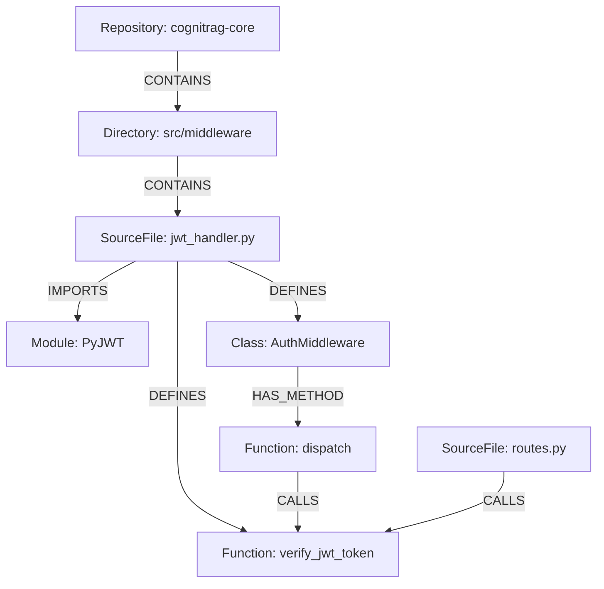

# Developer Code Studio: Full Implementation & Architecture Plan

**CognitRAG Persona 2:** Dedicated Codebase Intelligence, AST Knowledge Graph, Voice-to-Code Search powered by **Sarvam Saaras STT**, and Rate-Limited Ingestion.

---

## 1. Executive Vision & Core Problem

### The Problem
Engineers spend over **60% of their time** reading unfamiliar, sprawling codebases (50,000 to 500,000+ lines of code), tracing spaghetti function calls across microservices, and debugging legacy systems. Standard vector search fails on code because embeddings blur variable names, method signatures, and syntactic dependencies. Furthermore, naive code ingestion instantly exhausts free-tier LLM token limits (e.g. Groq 8,000 TPM) and crashes on bloated folders like `node_modules/` or `.git/`.

### The CognitRAG Moat
Developer Code Studio combines **Abstract Syntax Tree (AST) parsing**, a **Neo4j Code Graph**, **Strict Ingestion Rate-Limiting**, and **Sarvam Saaras Voice STT** to provide:
1. **Deterministic Call-Graph Traversal:** Knows exactly which functions call, import, or inherit from each other.
2. **Voice-to-Code Search in Indian Accents:** Developers can speak naturally while coding (*"Bhai authentication middleware me JWT verify kahan hota hai?"*), and Sarvam Saaras translates this directly into AST lookups.
3. **100% Verifiable Citations:** Never guesses code logic; links directly to file paths, exact line ranges, and caller trees.
4. **Guaranteed Zero-429 Rate-Limited Ingestion:** Automatic `.codeignore` filtering, 50-file upload caps, and a 6,000 TPM token-bucket throttler.

```
┌─────────────────────────────────────────────────────────────────────────────────────────┐
│                           DEVELOPER CODE STUDIO WORKSPACE                               │
├──────────────────────┬──────────────────────────────────────────┬───────────────────────┤
│ 📁 REPO EXPLORATOR   │ 💻 CODE & QUERY STUDIO                   │ 🕸️ AST CALL GRAPH     │
│ ├─ Branch: main ▼    │ ┌──────────────────────────────────────┐ │                       │
│ ├─ src/              │ │ [🎤 Speak (Saaras)] [🔍 Search Code] │ │ (server.py)           │
│ │  ├─ api/           │ └──────────────────────────────────────┘ │     │                 │
│ │  ├─ middleware/    │ async def verify_jwt_token(token: str):  │     ▼                 │
│ │  │  └─ jwt.py ⭐   │     """Verifies HMAC/RSA signatures"""   │ (auth_router.py)      │
│ │  └─ main.py        │     payload = jwt.decode(...)            │     │                 │
│ └─ Symbol Index      │     return payload["tenant_id"]          │     ▼                 │
│    ├─ verify_jwt()   │                                          │ (jwt_handler.py) ⭐   │
│    └─ AuthMiddleware │ AST Citation: jwt.py:L42-L58             │                       │
└──────────────────────┴──────────────────────────────────────────┴───────────────────────┘
```

---

## 2. Multi-Persona Authentication & Zero-Collision Scoping

### Strict 1-Login = 1-Persona (No Auto-Switch Mode)
Each persona is a dedicated, distraction-free environment. When a user creates a workspace for Developer Code Studio, the workspace is locked to that persona.

### How the Same Email Can Be Used Across All 3 Personas Without Collision:
If a developer uses `nitesh@example.com` for Developer Studio, Enterprise Brain, and Bharat Intelligence, the platform isolates them via **compound workspace identifiers**:

```
                       nitesh@example.com (Clerk User ID: user_99x)
                                       │
            ┌──────────────────────────┼──────────────────────────┐
            ▼                          ▼                          ▼
   [Developer Code Studio]    [Enterprise Brain]        [Bharat Intelligence]
   Workspace ID:              Workspace ID:             Workspace ID:
   ws_dev_99x                 ws_ent_99x                ws_bharat_99x
   Tenant ID: ws_dev_99x      Tenant ID: ws_ent_99x     Tenant ID: ws_bharat_99x
   ───────────────────────    ──────────────────────    ─────────────────────────
   • AST Code Graph           • Notion/Jira/Slack KG    • Bilingual OCR Invoices
   • GitHub Repositories      • PDF 10-K Reports        • WhatsApp Voice Notes
   • Code Embeddings          • Text Embeddings         • Indic OCR Chunks
```

1. Every database row in Supabase (`documents`, `chunks`, `embeddings`, `semantic_definitions`, `preference_memory`, `episodic_memory`) enforces `tenant_id = workspace_id`.
2. Every Neo4j node and relationship is tagged with `tenantId: workspace_id`.
3. In-Dashboard persona switching is disabled; each URL/session operates inside its own sandboxed workspace partition.

---

## 3. Tracking 1,000 Users Per Persona: Admin Analytics Dashboard

### Where to See the Metrics:
The platform administrator tracks signups, active users, and capacity at `/metrics` (or `/admin/personas`):

1. **3-Persona Capacity Gauges (Target: 1,000 Users Each):**
   - **👨‍💻 Developer Code Studio:** `X / 1,000` signups (Repositories Ingested, AST Nodes Parsed, Total LOC)
   - **🏢 Enterprise Company Brain:** `Y / 1,000` signups (Slack/Drive Integrations Connected, Queries Processed)
   - **🇮🇳 Bharat Document Intelligence:** `Z / 1,000` signups (Scanned Invoices Digitized, WhatsApp Audio Sessions)
2. **Audited User Roster Table:**
   - Real-time table: `User Email`, `Persona Assigned`, `Workspace ID`, `Files Ingested`, `Ingestion Status`, `API Calls Today`, `Rate-Limit Hits (0)`, `Last Active`.
3. **Backend API (`GET /api/v1/admin/persona-metrics`):**
   - Returns aggregated statistics directly from the Postgres `workspaces` table grouped by `persona_type`.

---

## 4. Ingestion Rate Limiting & File Upload Caps

### The Root Cause of API 429 Errors:
* **Groq Free Tier:** Strictly capped at **8,000 Tokens Per Minute (TPM)**.
* **NVIDIA NIM:** Free tier dynamically limits requests to **~40-50 RPM**.
* **Bloated Folders:** Unchecked uploads of `node_modules/`, `.git/`, or build artifacts explode into tens of thousands of tokens and crash the database.

### 4-Layer Ingestion Defense:

#### Layer 1: Strict User Upload Limits
| Parameter | Free Developer Tier | Pro Developer Tier |
| :--- | :--- | :--- |
| **Max Files per Ingestion** | **50 files** | **250 files** |
| **Max Total Lines of Code (LOC)** | **50,000 LOC** | **250,000 LOC** |
| **Max Zip Archive Size** | **10 MB** | **50 MB** |
| **Max Single File Size** | **500 KB** | **2 MB** |
| **Sync Frequency** | 1 full sync / hour | Real-time Webhook |

#### Layer 2: Automatic File Blacklisting (`.codeignore`)
Before parsing, the ingestion engine automatically prunes:
* **Directories:** `node_modules/`, `.git/`, `.next/`, `dist/`, `build/`, `__pycache__/`, `venv/`, `.venv/`, `coverage/`, `.idea/`, `.vscode/`
* **Files:** `package-lock.json`, `pnpm-lock.yaml`, `yarn.lock`, `poetry.lock`, `Cargo.lock`, `*.min.js`, `*.map`, `*.wasm`
* **Binaries & Assets:** `.png`, `.jpg`, `.svg`, `.mp4`, `.zip`, `.tar`, `.exe`, `.dll`, `.so`, `.pyc`
* **Allowed Extensions Only:** `.py`, `.js`, `.jsx`, `.ts`, `.tsx`, `.go`, `.rs`, `.java`, `.cpp`, `.c`, `.h`, `.sql`, `.json`, `.yaml`, `.md`

#### Layer 3: Token-Bucket Rate Limiter (`src/ingestion/rate_limiter.py`)
* **Token Budget:** Throttled to **6,000 TPM** (75% of Groq's 8,000 TPM limit).
* **Pacing Delay:** Between LLM entity extraction calls, calculates token consumption:
  $$\text{sleep\_seconds} = \max\left(0, \frac{\text{batch\_tokens}}{100} - \text{elapsed}\right)$$
* **Batch NVIDIA Embeddings:** Capped at 16 chunks per batch with a 1.5-second pacing delay to guarantee $< 40$ RPM.
* **Exponential Backoff:** If HTTP 429 is encountered, sleeps `[2s, 4s, 8s, 16s]` before retrying.

#### Layer 4: AST-First Semantic Chunking (Saves 65% of Tokens)
Instead of sliding-window text chunking (which wastes tokens on whitespace and comments), the AST parser extracts **only**:
1. Top-level functions & method signatures
2. Class definitions and interface contracts
3. Import statements & dependency trees

---

## 5. Neo4j Code Knowledge Graph Schema

The Code Knowledge Graph models structural dependencies rather than just fuzzy text embeddings:



### Node Labels & Properties:
* `(:Repository {id, name, default_branch, owner, total_loc, tenantId})`
* `(:SourceFile {path, filename, extension, sha, loc, tenantId})`
* `(:Class {name, start_line, end_line, docstring, is_exported, tenantId})`
* `(:Function {name, signature, start_line, end_line, docstring, return_type, is_async, tenantId})`
* `(:Symbol {name, type, tenantId})`

### Relationship Types:
* `[:CONTAINS]` — Repo contains directories and files.
* `[:DEFINES]` — File defines classes or top-level functions.
* `[:IMPORTS]` — File imports another module or symbol.
* `[:CALLS]` — Function invokes another function.
* `[:INHERITS]` — Class inherits from base class.

---

## 6. The 8-Stage Code Intelligence Chatbot Pipeline

```
[User Query: Text or Voice via Sarvam Saaras STT]
                      │
                      ▼
[Stage 1: Colloquial Normalization] ("Bhai auth middleware me JWT verify kahan hota hai?")
                      │ ──► Canonical: "JWT verification in authentication middleware"
                      ▼
[Stage 2: AST Symbol Extraction] ──► Extracted: `verify_jwt`, `AuthMiddleware`, `jwt`
                      │
                      ▼
[Stage 3: Neo4j Graph Traversal] ──► (:File)-[:DEFINES]->(:Function {name: 'verify_jwt'})
                      │              Caller: `dispatch` in `AuthMiddleware`
                      ▼
[Stage 4: Hybrid AST + Vector Search] ──► Scoped to `tenant_id = ws_dev_xxxx`
                      │
                      ▼
[Stage 5: Cross-Encoder Reranking] ──► Top 30 code snippets narrowed to top 5 verified chunks
                      │
                      ▼
[Stage 6: Context Assembly & Line Binding] ──► Line ranges: `jwt_handler.py:L42-L58`
                      │
                      ▼
[Stage 7: Deterministic Code Generation] ──► Verified Answer + Code Diff + Line Citations
                      │
                      ▼
[Stage 8: Sarvam Saaras TTS (Optional)] ──► Spoken answer in natural Indic voice
```

---

## 7. Phase-by-Phase Build Order

| Phase | Milestone | Deliverable |
| :--- | :--- | :--- |
| **Phase 2.1** | **Ingestion Rate-Limiter & Quota Guard** | `src/ingestion/rate_limiter.py` with 6,000 TPM token-bucket and 50-file upload limit. |
| **Phase 2.2** | **AST Code Parser & Graph Schema** | Python AST & tree-sitter extractor; Neo4j `(:Function)-[:CALLS]->(:Function)` graph generation. |
| **Phase 2.3** | **Multi-Persona Scoping & Admin API** | Zero-collision workspace assignment; `GET /api/v1/admin/persona-metrics` tracking 1,000 users per persona. |
| **Phase 2.4** | **3-Panel Frontend UI (`/dev-studio`)** | Build `/dev-studio` with Repo Explorer, Code Viewer, AST Graph, and Sarvam Saaras Voice STT. |
| **Phase 2.5** | **Admin Dashboard (`/metrics`)** | Live counters for 1,000 users per persona, active sessions, and zero-429 error tracking. |
| **Phase 2.6** | **Verification & Benchmarking** | Ingest test repository; verify rate limiting under high file count and check AST line citations. |
