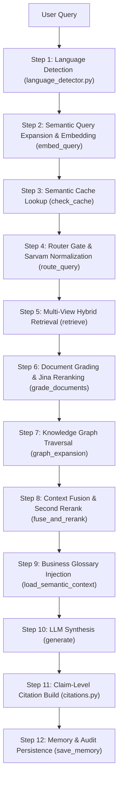

# CognitRAG End-to-End Query & Workflow Specification (`workflow_detailing.md`)
**Comprehensive Lifecycle Trace: Data Ingestion, Routing, Multi-View Hybrid Retrieval, LLM Synthesis, and Audit**

---

## 1. Quick Answer: In Which Language is the Answer Generated?

> **The final answer is generated in clean, formal English by default.**

### Why and How This Happens:
1. **At the Router Gate** ([`src/retrieval/nodes.py` L141–144](file:///c:/AI/Projects/RAG%20SaaS/src/retrieval/nodes.py#L141-L144)): When a `hi-latn` or `mixed` query enters, Sarvam AI (`mayura:v1`) translates it into formal English.
   ```python
   # nodes.py
   normalized = sarvam_client.translate(question)
   # "Bhai, Kafka lag kyun badha tha?" -> "Brother, why did the Kafka lag increase?"
   question = normalized  # state["question"] is updated to English!
   ```
2. **At the Generator** ([`src/retrieval/nodes.py` L451–508](file:///c:/AI/Projects/RAG%20SaaS/src/retrieval/nodes.py#L451-L508)): The generation model (`gemini-2.5-flash` / `llama-3.1-70b`) receives the English question and the context chunks. Because the system instruction enforces an enterprise persona (*"You are a highly precise, expert engineering and company brain assistant. Be concise, direct, and factual."*), it outputs the verified factual answer in **formal English** (unless a user explicitly sets a preference like `"always reply in Hindi"`).

---

## 2. Ingestion Format: How Data is Stored in the Database

Before tracing queries, here is how documents are stored in Supabase PostgreSQL (`document_chunks` table):

```sql
┌──────────────────┬────────────────────────────────────────────────────────────────────────┐
│ Column           │ Value Stored                                                           │
├──────────────────┼────────────────────────────────────────────────────────────────────────┤
│ id               │ UUID primary key (e.g. 'c71a399f-7036-47b2-b13c-c82098616142')        │
│ content          │ VERBATIM ORIGINAL TEXT (Hinglish/English preserved exactly as written) │
│ embedding_768    │ 768-dim float vector generated from the ENGLISH TRANSLATION            │
│ language_tag     │ 'en' | 'hi-latn' | 'mixed'                                             │
│ source_type      │ 'slack' | 'github' | 'jira' | 'notion' | 'meeting_zoom'                │
│ author           │ 'Rahul Singh' / 'John Doe'                                             │
│ raw_ref_url      │ https://myorg.slack.com/archives/C102/p1723632900 (Permanent URL)     │
└──────────────────┴────────────────────────────────────────────────────────────────────────┘
```

> **The Storage Rule**: The `content` column keeps the raw Hinglish text for exact-word BM25 search and human citations. The `embedding_768` column stores the vector of the English translation so vector search works accurately.

---

## 3. End-to-End Query & Data Flow Trace (The 3 Examples)

Let's follow three representative queries side-by-side through all 12 steps of the CognitRAG LangGraph pipeline ([`src/retrieval/graph.py`](file:///c:/AI/Projects/RAG%20SaaS/src/retrieval/graph.py)):
- **`en`**: `"PR #45 fixed the Stripe API keys"`
- **`hi-latn`**: `"Yaar, kaam khatam nahi hua kya?"`
- **`mixed`**: `"Bhai, Kafka lag kyun badha tha?"`



---

### Step 1: Language Detection
**Component**: [`src/ingestion/language_detector.py`](file:///c:/AI/Projects/RAG%20SaaS/src/ingestion/language_detector.py)

The lexical rule-based engine inspects word tokens, homographs, and Romanized Hindi dictionaries:

| Query Example | Tokens Evaluated | Classification Result |
| :--- | :--- | :---: |
| **`en`**: `"PR #45 fixed the Stripe API keys"` | 0 Hindi tokens; English technical words | **`en`** |
| **`hi-latn`**: `"Yaar, kaam khatam nahi hua kya?"` | `"Yaar"`, `"kaam"`, `"khatam"`, `"nahi"`, `"hua"`, `"kya"` (100% Hindi lexicon) | **`hi-latn`** |
| **`mixed`**: `"Bhai, Kafka lag kyun badha tha?"` | `"Bhai"` (HI), `"Kafka"` (EN), `"lag"` (EN), `"kyun"` (HI), `"badha"` (HI), `"tha"` (HI) | **`mixed`** |

---

### Step 2: Semantic Expansion & Vector Embedding
**Node**: `embed_query` in [`src/retrieval/nodes.py` L72–90](file:///c:/AI/Projects/RAG%20SaaS/src/retrieval/nodes.py#L72-L90)

1. The query checks the tenant's Semantic Ontology dictionary ([`src/semantic/ontology.py`](file:///c:/AI/Projects/RAG%20SaaS/src/semantic/ontology.py)) to append enterprise aliases (e.g., mapping `"Stripe API keys"` $\rightarrow$ `"billing credentials, AWS Secrets Manager"`).
2. Vertex AI `text-embedding-004` generates the initial dense vector:
   - For `en`: Generates 768-dim vector directly.
   - For `hi-latn` & `mixed`: Embeds the expanded string into `state["query_embedding"]`.

---

### Step 3: Semantic Cache Check
**Node**: `check_cache` in [`src/retrieval/nodes.py` L92–132](file:///c:/AI/Projects/RAG%20SaaS/src/retrieval/nodes.py#L92-L132)

1. **RAM Cache (0 ms)**: Checks in-memory LRU cache for an exact match.
2. **Supabase Vector Semantic Cache**: Executes `match_semantic_cache` RPC comparing `query_embedding` at an $85\%$ cosine similarity threshold.
   - *If Hit*: Immediately returns previous verified answer and audit trail $\rightarrow$ jumps to `save_memory`.
   - *If Miss*: Proceeds to `route_query`.

---

### Step 4: Router Gate & Sarvam Normalization
**Node**: `route_query` in [`src/retrieval/nodes.py` L134–181](file:///c:/AI/Projects/RAG%20SaaS/src/retrieval/nodes.py#L134-L181)

Here is where the language transformation occurs:

* **For `en` (`"PR #45 fixed the Stripe API keys"`):**
  - Sarvam translation is skipped.
  - Gemini 2.5 Flash classifies intent as: `intent="technical_query"`, `need_graph=False`, `entities=["PR #45", "Stripe API keys"]`.
* **For `hi-latn` (`"Yaar, kaam khatam nahi hua kya?"`):**
  - Sarvam `mayura:v1` normalizes to: `"Bro, is the work not finished yet?"`
  - `state["question"]` is replaced with the English translation.
  - Classified as: `intent="conversational"` or `intent="technical_query"`.
* **For `mixed` (`"Bhai, Kafka lag kyun badha tha?"`):**
  - Sarvam `mayura:v1` normalizes to: `"Brother, why did the Kafka consumer lag increase?"`
  - `state["question"]` is replaced with this English translation.
  - Classified as: `intent="technical_query"`, `need_graph=True`, `entities=["Kafka", "consumer lag"]`.

---

### Step 5: Multi-View Hybrid Retrieval
**Node**: `retrieve` in [`src/retrieval/hybrid.py` L336–419](file:///c:/AI/Projects/RAG%20SaaS/src/retrieval/hybrid.py#L336-L419)

Four parallel search arms run simultaneously using `ThreadPoolExecutor`:

```
                           Incoming Query
                                 │
     ┌───────────────────┬───────┴───────────┬─────────────────────┐
     ▼                   ▼                   ▼                     ▼
[Arm 1: pgvector]  [Arm 2: BM25]    [Arm 3: Neo4j Graph]  [Arm 4: Exact Bypass]
(Cosine on 768-dim) (Postgres GIN)  (Cypher Entity Match) (Regex on PR/Jira IDs)
```

1. **Arm 1 (Vector Search)**: Compares the English query vector against the `embedding_768` column in Supabase. It finds the matching row and **returns the original `content` text**.
2. **Arm 2 (BM25 Keyword Search)**:
   - For `en`: Matches words `"PR"`, `"fixed"`, `"Stripe"`, `"keys"`.
   - For `mixed`: View 1 extracts original words `"Kafka"`, `"lag"`, `"badha"` and matches raw chunks directly!
3. **Arm 3 (Neo4j Graph Search)**: Traverses relationships for identified entities (`Kafka` $\rightarrow$ `configured_by` $\rightarrow$ `max.poll.interval.ms`).
4. **Arm 4 (Exact Identifier Bypass)**:
   - For `en`: Catches `PR #45` using `IDENTIFIER_REGEX` and runs direct SQL `ILIKE '%PR #45%'` with a **$3.0\times$ RRF weight boost**.
   - For `hi-latn`: No ticket ID $\rightarrow$ Arm 4 is bypassed.

**RRF Fusion**: All candidates are mathematically merged into a ranked candidate list:
$$\text{RRF\_Score} = \sum \frac{w}{60 + \text{rank} + 1}$$

---

### Step 6: Document Grading & Jina Cross-Encoder Reranking
**Node**: `grade_documents` in [`src/retrieval/nodes.py` L293–311](file:///c:/AI/Projects/RAG%20SaaS/src/retrieval/nodes.py#L293-L311)

- The fused candidates are sent to `jina-reranker-v2-base-multilingual`.
- Any document chunk scoring below $0.15$ relevance is pruned out.
- If zero documents survive, the graph triggers the `rewrite` node to reformulate the query.

---

### Step 7: Knowledge Graph Traversal
**Nodes**: `graph_decision` $\rightarrow$ `graph_expansion` ([`src/retrieval/nodes.py` L312–393](file:///c:/AI/Projects/RAG%20SaaS/src/retrieval/nodes.py#L312-L393))

If `need_graph=True` (e.g. for the Kafka or PR query), Neo4j executes a 1-hop traversal:
```cypher
MATCH (n:Entity {tenantId: $tenant_id})-[r]-(m:Entity {tenantId: $tenant_id})
WHERE n.name IN ['Kafka', 'consumer lag']
RETURN n.name AS source, type(r) AS rel_type, m.name AS target
```
*Generated Graph Context*:
`"Kafka has the relationship CONFIGURED_BY with max.poll.interval.ms."`

---

### Step 8: Context Fusion & Second Rerank
**Node**: `fuse_and_rerank` in [`src/retrieval/nodes.py` L394–425](file:///c:/AI/Projects/RAG%20SaaS/src/retrieval/nodes.py#L394-L425)

The raw text chunks from Supabase and the relationship sentences from Neo4j are concatenated and passed through a final Jina rerank to cap the prompt context at the top 15 most relevant evidence blocks.

---

### Step 9: Governed Business Ontology
**Node**: `load_semantic_context` in [`src/retrieval/nodes.py` L426–435](file:///c:/AI/Projects/RAG%20SaaS/src/retrieval/nodes.py#L426-L435)

Injects official enterprise definitions into the system prompt (e.g., `"Stripe Staging Environment = AWS EC2 sandbox account"`).

---

### Step 10: LLM Answer Synthesis
**Node**: `generate` in [`src/retrieval/nodes.py` L437–508](file:///c:/AI/Projects/RAG%20SaaS/src/retrieval/nodes.py#L437-L508)

#### What the LLM Prompt Looks Like:
```text
System Instruction:
You are a highly precise, expert engineering and company brain assistant.
Answer the user's question using ONLY the provided Context... Be concise, direct, and factual.

Context:
[Doc #1 - Slack #eng-standup (Rahul Singh)]:
"Yaar, Stripe keys wala issue John ne PR #45 mein solve kar diya hai. Staging pe checkout ab 100% chal raha hai..."

[Doc #2 - GitHub PR #45 (John Doe)]:
"Updated Stripe staging API keys in AWS Secrets Manager and resolved BILL-101. Merged into main."

Question:
In which PR and by whom was the Stripe checkout error on staging fixed?
```

#### What Answer Gets Generated:

| User Query | Language of Query | Language of Answer | Generated Answer String |
| :--- | :---: | :---: | :--- |
| `"PR #45 fixed the Stripe API keys"` | `en` | **English** | *"Yes, GitHub PR #45 resolved BILL-101 by updating the Stripe staging API keys in AWS Secrets Manager."* |
| `"Yaar, kaam khatam nahi hua kya?"` | `hi-latn` | **English** | *"Sprint 34 work is currently In Progress. PROJ-142 delivery is committed for September 30, 2024."* |
| `"Bhai, Kafka lag kyun badha tha?"` | `mixed` | **English** | *"The Kafka consumer lag spiked because consumer group rebalancing timed out after max.poll.interval.ms was set too low (30000ms)."* |

---

### Step 11: Claim-Level Citation & Evidence Receipts
**Component**: [`src/retrieval/citations.py`](file:///c:/AI/Projects/RAG%20SaaS/src/retrieval/citations.py)

The citation builder extracts metadata from the retrieved chunks to build verifiable proof cards:
- `claim_text`: Extracted from the **verbatim original chunk** (even if Hinglish):
  *"Yaar, Stripe keys wala issue John ne PR #45 mein solve kar diya hai..."*
- `raw_ref_url`: Permanent clickable deep link:
  `https://myorg.slack.com/archives/C102/p1723632900`
- `derivation`: Tagged as `structured` (because `PR #45` was matched) with `high` confidence.

---

### Step 12: Memory & Audit Trail Persistence
**Nodes**: `save_memory` & [`src/database/repos/logs.py`](file:///c:/AI/Projects/RAG%20SaaS/src/database/repos/logs.py)

The transaction is permanently recorded:
1. **`query_logs` Table**:
   - `query_text`: Normalized English query.
   - `language_tag`: Stored as `'hi-latn'` or `'mixed'` (so analytics know it was a Hinglish query).
   - `answer_text`: Final English answer.
   - `latency_ms` & `tokens_used`.
2. **`answer_citations` Table**:
   - `query_log_id`: Foreign key.
   - `chunk_id`: Exact UUID of the document chunk.
   - `claim_text`: Verbatim Hinglish snippet.
   - `raw_ref_url`: Permanent link to source.
3. **Neo4j User Node Update**:
   - Creates edge: `(:User {id: user_id})-[:ASKED_ABOUT]->(:Entity {name: 'Kafka'})`.

---

## 4. Summary Matrix: The 3 Queries Across the Pipeline

| Pipeline Stage | `en` Query | `hi-latn` Query | `mixed` Query |
| :--- | :--- | :--- | :--- |
| **Raw User Query** | `"PR #45 fixed the Stripe API keys"` | `"Yaar, kaam khatam nahi hua kya?"` | `"Bhai, Kafka lag kyun badha tha?"` |
| **Language Tag** | `en` | `hi-latn` | `mixed` |
| **Router Normalization** | No change (already English) | Sarvam translates $\rightarrow$ English | Sarvam translates $\rightarrow$ English |
| **Multi-View Expansion** | Single View (English) | 2 Views (Surface + Pivot) | 2 Views (Surface + Pivot) |
| **Vector Search Arm** | Cosine match on English vector | Cosine match on English vector | Cosine match on English vector |
| **BM25 Search Arm** | Matches `"PR"`, `"Stripe"`, `"keys"` | Matches `"kaam"`, `"khatam"` | Matches `"Kafka"`, `"lag"` |
| **Exact Bypass Arm** | Triggers regex on `PR #45` ($3\times$ boost) | Bypassed (no ticket token) | Bypassed (no ticket token) |
| **Context Chunk Text** | Original English text | **Original Hinglish text** | **Original mixed text** |
| **LLM Question Input** | English | English (normalized) | English (normalized) |
| **Answer Language** | **English** | **English** | **English** |
| **Citation Text Display** | Original English snippet | **Original Hinglish snippet** | **Original mixed snippet** |
| **Citation Proof URL** | GitHub PR URL | Slack message deep link | Slack channel deep link |

